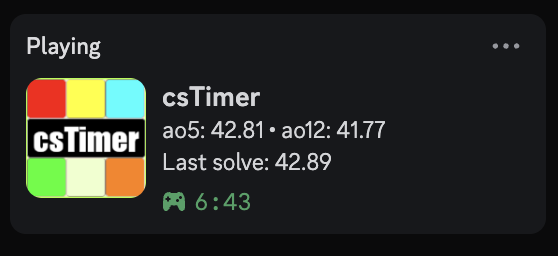

# csTimer Discord RPC

Shows your [csTimer](https://cstimer.net) ao5, ao12 and last solve in your Discord status.



The project runs on macOS, Linux and Windows with the Discord desktop app and a Chromium-based browser: Chrome, Chromium, Brave, Edge, Vivaldi, Arc, Opera or Helium. Only macOS with Helium has been tested end to end. Linux and Windows support is untested. It has no npm dependencies.

## Language

The status follows your browser language by default. To change it, click the extension icon and pick one of the 10 available languages: English, French, Spanish, German, Portuguese, Italian, Russian, Chinese, Japanese or Korean.

To hide the status without closing csTimer, turn off **Show on Discord** in the same menu.

## How it works

An extension alone cannot talk to the Discord app, so the project has two parts:

```
cstimer.net ──> extension ──> native host ──> Discord app
              "avg" signal  Native Messaging  discord-ipc socket
```

- **The extension** subscribes to csTimer's `avg` signal and forwards the stats. It does not read the page HTML.
- **The native host** (`host/`) formats the stats and sends them to Discord over its local socket.

You never start anything yourself. The browser starts the host when the first stats arrive and stops it when the last csTimer tab closes, which clears the status. The host does not run permanently and opens no network port.

## Installation

You need Node.js, a Chromium-based browser and the Discord desktop app.

1. Create an application on the [Discord Developer Portal](https://discord.com/developers/applications). Its name becomes the title shown on your profile.
2. Copy its **Application ID**, then run:
   ```sh
   # macOS and Linux
   ./install.sh <application_id>
   ```
   ```powershell
   # Windows
   powershell -ExecutionPolicy Bypass -File install.ps1 <application_id>
   ```
3. In your browser, open `chrome://extensions`, enable developer mode, click **Load unpacked** and select the `extension` folder.
4. Reload cstimer.net with the Discord app open.

`install.sh` writes `host/config.json` and `host/run.sh`, both ignored by git, plus a Native Messaging manifest in the folder of each detected browser. If yours is not recognized, pass its data folder:

```sh
CHROMIUM_DATA_DIR="$HOME/Library/Application Support/MyBrowser" ./install.sh <application_id>
```

On Windows, `install.ps1` registers the host in the registry for Chrome, Chromium, Brave, Edge and Vivaldi. For another browser, pass its registry key:

```powershell
powershell -ExecutionPolicy Bypass -File install.ps1 <application_id> -RegistryKey 'Vendor\Browser'
```

On Linux, browsers installed through Snap or Flatpak are sandboxed and may refuse to start the host. Discord itself can be installed either way.

The generated files store the project path and the Node.js path. If either changes, run the installer again and reload the extension.

## Uninstall

1. Remove the extension from `chrome://extensions`.
2. Delete the manifests:
   ```sh
   # macOS
   find "$HOME/Library/Application Support" -path '*/NativeMessagingHosts/local.cstimer_discord_rpc.json' -delete
   # Linux
   find "${XDG_CONFIG_HOME:-$HOME/.config}" -path '*/NativeMessagingHosts/local.cstimer_discord_rpc.json' -delete
   ```
   ```powershell
   # Windows
   powershell -ExecutionPolicy Bypass -File install.ps1 -Uninstall
   ```
3. Delete the project folder.

## Limitations

- The two averages shown are the first two configured in csTimer: ao5 and ao12 by default.
- Before reaching 5 or 12 solves, an average shows `-`, or the best possible average (`bpa5`) when one solve short.
- The status stays visible while a csTimer tab is open, even if you stop solving.
- With several csTimer tabs open, the tab that last recorded a solve sets the status.

## Troubleshooting

| Symptom | What to check |
|---|---|
| Nothing on Discord | The Discord desktop app is open and activity sharing is enabled in its settings. |
| Still nothing on Discord | In `chrome://extensions`, open the extension's service worker and read its console. |
| `Specified native messaging host not found` | The installer was not run, or the folder was moved. |
| `Access to the specified native messaging host is forbidden` | The extension ID does not match: the `key` field in `manifest.json` changed. |

## Project layout

```
extension/
  page.js              reads the avg signal in the page
  bridge.js            relays stats to the service worker
  background.js        manages the native host connection
  popup.html, popup.js language menu
  languages.js         languages listed in the menu
host/
  host.js              entry point started by the browser
  presence.js          formats stats for Discord
  languages.js         translated status text
  discord-ipc.js       Discord socket client with reconnect
  native-messaging.js  Native Messaging protocol
test/                  unit and end-to-end tests
install.sh             installer for macOS and Linux
install.ps1            installer for Windows
```

## Tests

```sh
npm test                  # unit tests and fake Discord server
node test/e2e-browser.js  # real browser (throwaway profile) and real cstimer.net
```

`e2e-browser.js` uses Helium by default; set `BROWSER_BINARY` to pick another browser. It uses a fake Discord, a temporary profile and a throwaway copy of `host/`, so it touches neither your status, your profile nor your configuration.

## License

[MIT](LICENSE)
